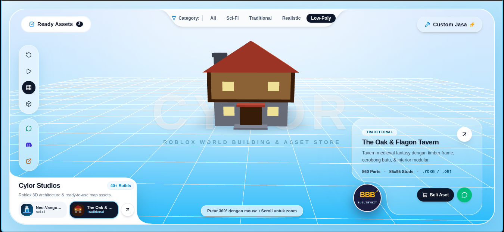
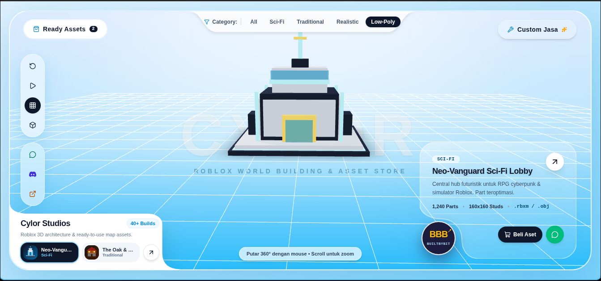

# Cylor Studios — Roblox 3D Architecture & Asset Store

<p align="center">
  
</p>

> **Platform Portofolio Interaktif 3D Berbasis Web untuk Jasa Building & Toko Model 3D Siap Pakai Roblox.**  
> Dikembangkan sebagai proyek real bisnis mata kuliah Kewirausahaan.

---

## 📌 Sekilas Proyek

Di ekosistem pengembangan game **Roblox**, waktu dan tenaga adalah faktor krusial. Banyak pengembang game (developer) membutuhkan bangunan dan objek 3D berkualitas tinggi tetapi terhambat oleh proses pembuatan (*3D modeling & building*) yang memakan waktu lama.

**Cylor Studios** hadir memberikan dua solusi utama:
1. **Ready-Made 3D Models & Assets**: Model bangunan siap pakai yang dapat langsung dibeli melalui marketplace seperti **[BuiltByBit](https://builtbybit.com/resources/roblox)**.
2. **Custom Building & Prop Commissions**: Layanan jasa pembuatan bangunan (*custom landmark/building*) dan benda/prop tematik sesuai brief klien, dengan alur diskusi leluasa via **Discord**.

Website portofolio ini dirancang mengusung konsep **Single-Screen Bento-Glassmorphism** dengan **Interactive 3D WebGL Canvas** di tengah layar, memungkinkan calon pelanggan melihat, memutar 360°, dan memeriksa detail bangunan Roblox secara langsung di browser sebelum membeli.

---

## 📸 Preview Antarmuka

| Mode Ready Assets | Mode Custom Jasa |
| :---: | :---: |
|  |  |
| *Katalog bangunan siap pakai dengan tautan langsung ke toko BuiltByBit* | *Layanan jasa custom building & prop dengan alur order ke Discord* |

---

## ✨ Fitur Utama

- 🌐 **Interactive 3D WebGL Viewport**: Merender model 3D `.obj` + `.mtl` hasil ekspor dari Roblox Studio secara *real-time*. Mendukung *orbit rotation 360°*, *zoom*, pencahayaan *sunlight & rim light*, serta *contact shadows*.
- 🎨 **Modern Bento-Glassmorphism UI**: Antarmuka transparan (*frosted glass*) dengan kurva organik (*fluid concave fillet curves*) yang dinamis dan berdaya tarik visual tinggi.
- 🗂️ **Interactive Model Switcher**: Mengganti model 3D di layar secara instan lewat *dock* bawah tanpa me-reload halaman.
- 🎛️ **Studio Viewport Controls**:
  - **Reset Camera**: Mengembalikan sudut pandang kamera ke posisi default.
  - **Auto-Rotate 360°**: Memutar model 3D otomatis untuk presentasi visual.
  - **Stud Grid Helper**: Menampilkan grid ukuran stud ala Roblox Studio.
  - **Wireframe Toggle**: Melihat struktur jaring poligon (*mesh geometry*) model Roblox.
- 🔗 **Integrasi Pihak Ketiga**:
  - Tombol emblem **BuiltByBit (`BBB ↗`)** untuk transaksi instan aset jadi.
  - Tombol emblem **Discord (`Discord ↗`)** untuk konsultasi brief dan spesifikasi custom build.

---

## 🛠️ Tech Stack

- **Frontend Core**: [React 19](https://react.dev/), [TypeScript](https://www.typescriptlang.org/), [Vite](https://vite.dev/)
- **3D Graphics & WebGL**: [Three.js](https://threejs.org/), [@react-three/fiber](https://docs.pmnd.rs/react-three-fiber), [@react-three/drei](https://github.com/pmndrs/drei)
- **Styling**: [Tailwind CSS v4](https://tailwindcss.com/)
- **Icons**: [Lucide React](https://lucide.dev/)

---

## 📁 Struktur Direktori

```text
CylorStudios-roblox/
├── public/
│   ├── models/                   # Folder aset ekspor Roblox (.obj & .mtl)
│   │   ├── medieval-tavern/
│   │   └── scifi-lobby/
│   ├── thumbnails/               # Ikon & thumbnail model
│   └── preview/                  # Screenshot tangkapan layar untuk dokumentasi
├── src/
│   ├── config/
│   │   └── studio.config.ts      # Konfigurasi link sosial media & toko
│   ├── data/
│   │   ├── assets.data.ts        # Data portofolio bangunan 3D
│   │   └── services.data.ts      # Varian paket layanan jasa building & prop
│   ├── types/
│   │   └── portfolio.types.ts    # Definisi TypeScript interface
│   ├── components/
│   │   ├── canvas/               # Engine 3D Canvas, Loader, & Model Normalizer
│   │   │   ├── StudioCanvas.tsx
│   │   │   ├── RobloxModel.tsx
│   │   │   └── CanvasLoader.tsx
│   │   └── hud/                  # Komponen UI Bento-Glass
│   │       ├── TopNavbar.tsx
│   │       ├── LeftControlRail.tsx
│   │       ├── BottomLeftDock.tsx
│   │       └── BottomRightCard.tsx
│   ├── App.tsx                   # State utama aplikasi
│   ├── index.css                 # Styling global & glassmorphism
│   └── main.tsx
├── package.json
└── vite.config.ts
```

---

## 🚀 Memulai (Getting Started)

### Prasyarat
- [Node.js](https://nodejs.org/) (versi 18 ke atas disarankan)
- Package manager npm / yarn / pnpm

### Instalasi & Menjalankan Lokal

1. **Clone repository ini:**
   ```bash
   git clone <URL_REPOSITORY>
   cd CylorStudios-roblox
   ```

2. **Pasang dependensi:**
   ```bash
   npm install
   ```

3. **Jalankan local development server:**
   ```bash
   npm run dev
   ```
   Buka browser di `http://localhost:5173`.

4. **Build untuk produksi:**
   ```bash
   npm run build
   ```

---

## 🧱 Cara Menambahkan Model Roblox Baru

1. Di **Roblox Studio**, pilih model/grup bangunan Anda.
2. Klik kanan lalu pilih **Export Selection...**, simpan sebagai `model.obj` (file `.mtl` akan otomatis dibuat oleh Roblox Studio).
3. Buat folder baru di `public/models/<nama-model>/` dan letakkan file `model.obj` serta `model.mtl` di dalamnya.
4. Buka [`src/data/assets.data.ts`](src/data/assets.data.ts) dan tambahkan entri baru:
   ```ts
   {
     id: 'nama-model',
     title: 'Nama Bangunan',
     category: 'Sci-Fi', // 'Low-Poly' | 'Realistic' | 'Sci-Fi' | 'Traditional'
     description: 'Deskripsi singkat bangunan...',
     stats: {
       partsCount: '1,500 Parts',
       dimensions: '120x120 Studs',
       fileFormat: '.rbxm / .obj',
     },
     thumbnailUrl: '/thumbnails/nama-model.svg',
     modelPaths: {
       obj: '/models/nama-model/model.obj',
       mtl: '/models/nama-model/model.mtl',
     },
     externalLinks: {
       builtByBitUrl: 'https://builtbybit.com/resources/roblox',
     },
   }
   ```
   Model akan langsung otomatis muncul di switcher dan dapat dieksplorasi secara 3D di website.

---

## 👤 Tim & Kontak

**Cylor Studios** — Roblox 3D Architecture & Map Engineering  
- 💬 **Discord**: [Join Discord Server](https://discord.gg/your-invite-code)
- 🛒 **BuiltByBit**: [BuiltByBit Roblox Resources](https://builtbybit.com/resources/roblox)
- 📱 **WhatsApp**: [Chat via WhatsApp](https://wa.me/6281234567890)
